<div align="center">


# Langkah

**Pengelola tugas dan catatan yang tenang.**<br>
Tangkap pikiran, pilih yang penting hari ini, kerjakan satu per satu.

Gratis · tanpa akun · tanpa server · bisa dipasang di HP · bisa dipakai di beberapa perangkat

[**Buka aplikasi**](https://farhanimaduddin.me/langkah/) · [Fitur](#fitur) · [Data disimpan di mana](#di-mana-data-disimpan) · [Beberapa perangkat](#pakai-di-beberapa-perangkat-opsional) · [Memasang](#memakai-langkah) · [Kontribusi](#kontribusi-dan-saran)

</div>

<p align="center">
  
</p>

> Semua tangkapan layar memakai **data contoh** (`data-contoh.json`), bukan data pribadi.

---

## Untuk siapa

Untuk siapa saja yang daftar tugasnya sering terasa terlalu panjang untuk dimulai. Tidak perlu paham teknologi: buka alamatnya, langsung pakai.

- **Pekerja kantor**: memisahkan kerjaan, projek, dan catatan rapat, lalu fokus ke yang harus beres hari ini.
- **Pelajar dan mahasiswa**: memecah tugas besar seperti makalah atau skripsi jadi langkah kecil, lengkap dengan timer belajar.
- **Freelancer dan kreator konten**: beberapa klien atau kanal sekaligus, tiap projek dengan progresnya sendiri.
- **Urusan rumah dan pribadi**: belanja, tagihan, janji, dan ide yang muncul tiba-tiba.

Tampilannya sengaja dibuat tenang dan tidak menuntut. Itu membantu semua orang, terutama yang mudah terdistraksi, cepat kewalahan, atau punya ADHD.

## Kenapa berbeda

| Prinsip | Wujudnya di aplikasi |
|---|---|
| **Tampilkan sedikit** | Hari Ini hanya berisi yang kamu pilih untuk hari ini. Sisanya aman di Nanti. |
| **Tangkap dulu, putuskan nanti** | Apa pun yang terlintas ditulis di satu kolom, lalu dipilah satu per satu. |
| **Tugas besar dipecah** | Setiap tugas bisa punya langkah kecil. Mode Fokus hanya menampilkan satu langkah. |
| **Tidak menghukum** | Tidak ada daftar "terlambat" berwarna merah. Yang belum dipilah pindah sendiri ke Nanti. |
| **Selalu bisa dibatalkan** | Hapus, pindah, dan selesai bisa di-undo. Yang dibuang tersimpan di Sampah 30 hari. |
| **Datamu milikmu** | Tidak ada server atau akun. Data ada di perangkatmu sendiri. |

---

## Fitur

### 1. Tangkap dan pilah
Ketik apa saja di kolom **Tangkap pikiran**. `Enter` menyimpannya sebagai tugas, `Ctrl+Enter` sebagai catatan, dan di HP ada tombol **Tambah**. Tangkapan baru muncul satu per satu untuk dipilah: **Hari ini**, **Nanti**, atau **Buang**. Kalau bingung mulai dari mana, **Pilihkan satu** akan memilihkan satu tugas dari Hari Ini (lihat gambar di atas).

Tangkapan yang belum dipilah sampai besok pagi otomatis pindah ke Nanti. Tugas Hari Ini yang belum selesai tetap di Hari Ini dengan penanda "dari hari sebelumnya", tanpa label terlambat.

### 2. Tugas dipecah jadi langkah kecil
Setiap tugas bisa punya daftar langkah yang bisa dicentang, diurutkan, dan ditambah kapan saja. Tugas otomatis selesai begitu semua langkahnya tercentang. Tugas juga bisa dimasukkan ke projek dan difilter menurut kerjaan.

<p align="center">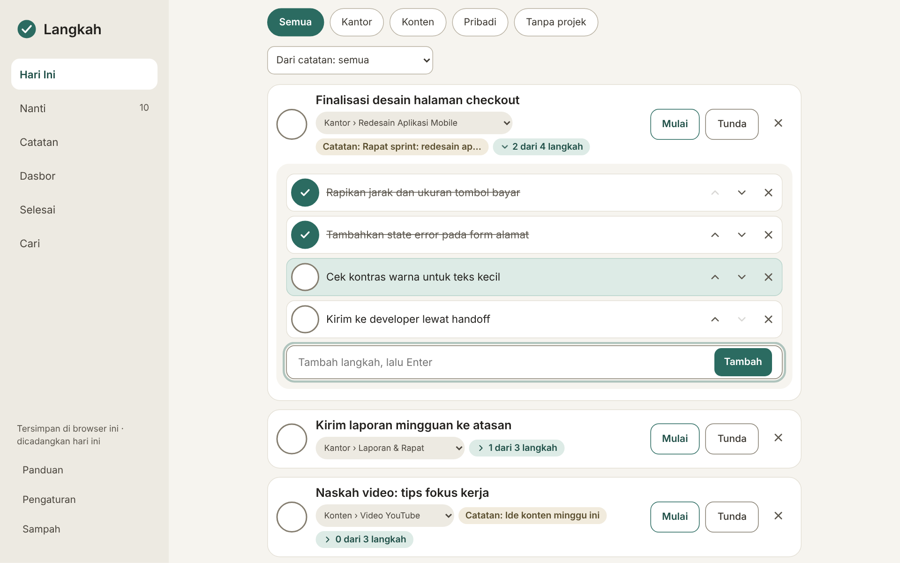</p>

### 3. Mode Fokus dan timer
Mode Fokus menampilkan **satu langkah** saja dengan jam besar. Timer bisa dipilih cepat (10, 15, 25 menit) atau diisi **menit sendiri** dari 1 sampai 720. Ada kolom **"Ada yang terlintas?"** untuk mencatat pikiran yang mengganggu tanpa keluar dari fokus.

<table>
  <tr>
    <td width="50%"></td>
    <td width="50%">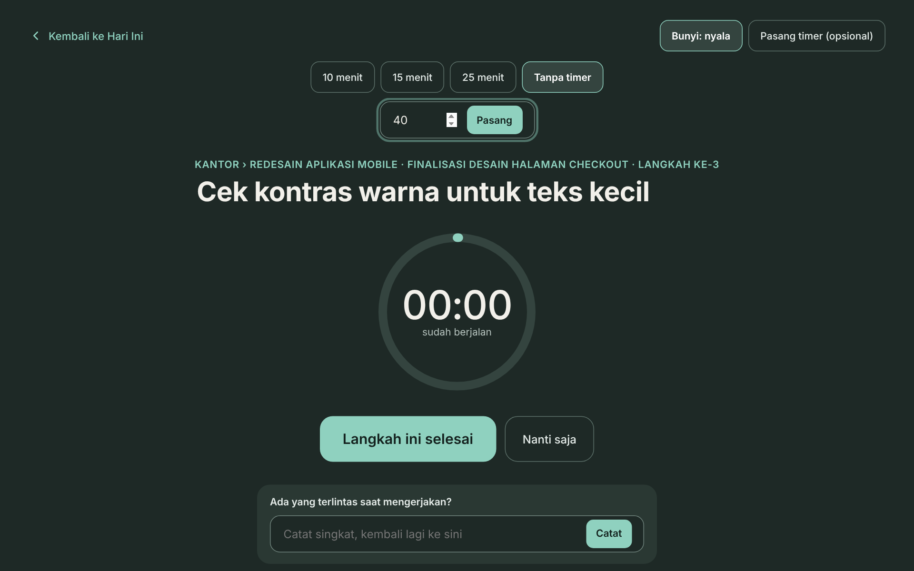</td>
  </tr>
  <tr>
    <td align="center"><sub>Satu langkah, satu timer</sub></td>
    <td align="center"><sub>Tombol cepat atau menit sendiri</sub></td>
  </tr>
</table>

### 4. Beberapa tugas berjalan bersamaan
Keluar dari Mode Fokus tidak mengakhiri sesi. Setiap tugas yang berjalan tampil sebagai bar di atas halaman, dengan jam yang terus berjalan dan tombol **Lanjutkan** atau **Akhiri**. Cocok untuk kerja yang menunggu, misalnya proses render, masakan, atau cucian.

Saat waktu habis, bar berubah oranye, nada berbunyi (berulang tiap 10 detik sampai 1 menit), perangkat bergetar, dan notifikasi muncul.

<table>
  <tr>
    <td width="50%">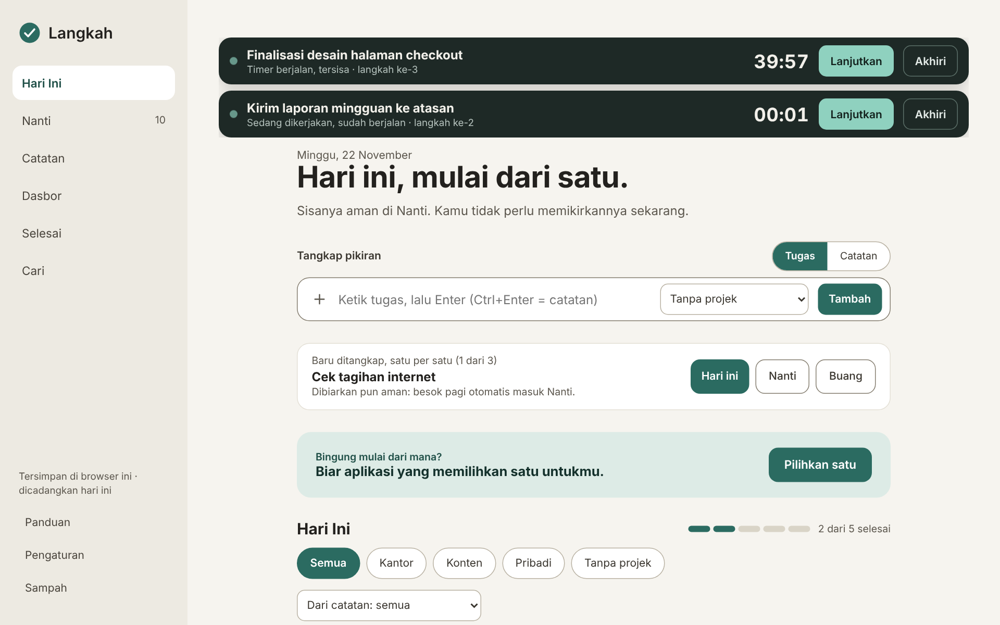</td>
    <td width="50%">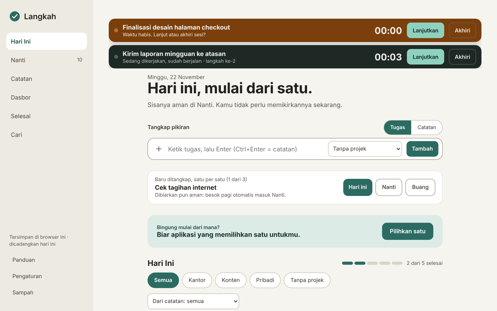</td>
  </tr>
  <tr>
    <td align="center"><sub>Dua sesi, masing-masing dengan timernya</sub></td>
    <td align="center"><sub>Waktu habis</sub></td>
  </tr>
</table>

### 5. Notifikasi dan bunyi
- Notifikasi **"Sedang dikerjakan"** menyebut nama tugas dan jam selesainya, dengan tombol **Selesai** dan **Akhiri sesi**.
- Notifikasi **"Waktu habis"** punya tombol **+5 menit** dan **Akhiri**.
- **Selalu tampil**: kalau notifikasi tugas berjalan digeser, ia muncul lagi sampai sesinya diakhiri. Bisa dimatikan.
- Halaman pengaturan menunjukkan status izin notifikasi, cara menyalakannya bila diblokir, dan tombol **Tes** untuk memeriksanya, termasuk tes 10 detik untuk dicoba saat layar terkunci.

<p align="center">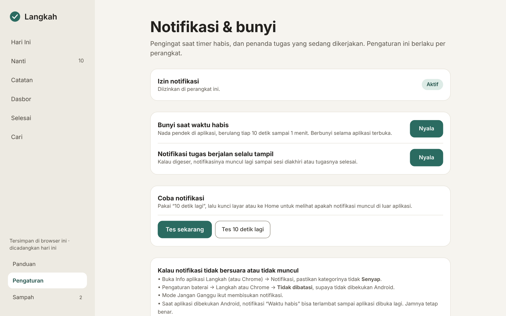</p>

### 6. Nanti
Tempat aman untuk semua yang belum perlu dipikirkan hari ini. Pilih filter kerjaan untuk melihatnya per projek, atau filter catatan untuk melihat tugas dari satu catatan. Satu ketukan untuk memindahkannya ke Hari Ini.

<p align="center">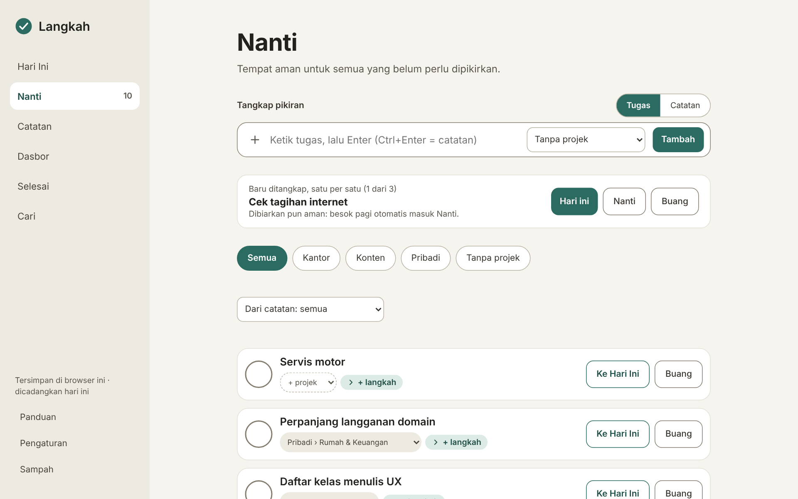</p>

### 7. Catatan
Catatan punya **judul dan isi** yang boleh panjang, cocok untuk notulen rapat, ide, atau rencana. Daftar catatan bisa **difilter** (Catatan saja, Berjalan, Tuntas, per projek), **dicari**, **disematkan**, dan **diurutkan** menurut waktu: terakhir diubah, terbaru dibuat, atau terlama dibuat.

<p align="center"></p>

Klik catatan untuk membuka **halaman detailnya**: isi lengkap, kapan dibuat dan diubah, dan daftar tugas yang lahir darinya. **Blok sebagian tulisan**, lalu tekan **+ Tugas dari catatan ini**, dan judul tugas langsung terisi. Satu catatan bisa melahirkan banyak tugas, bahkan ke projek yang berbeda. Statusnya dihitung otomatis: **Catatan** (belum ada tugas), **Berjalan**, atau **Tuntas**.

<table>
  <tr>
    <td width="50%">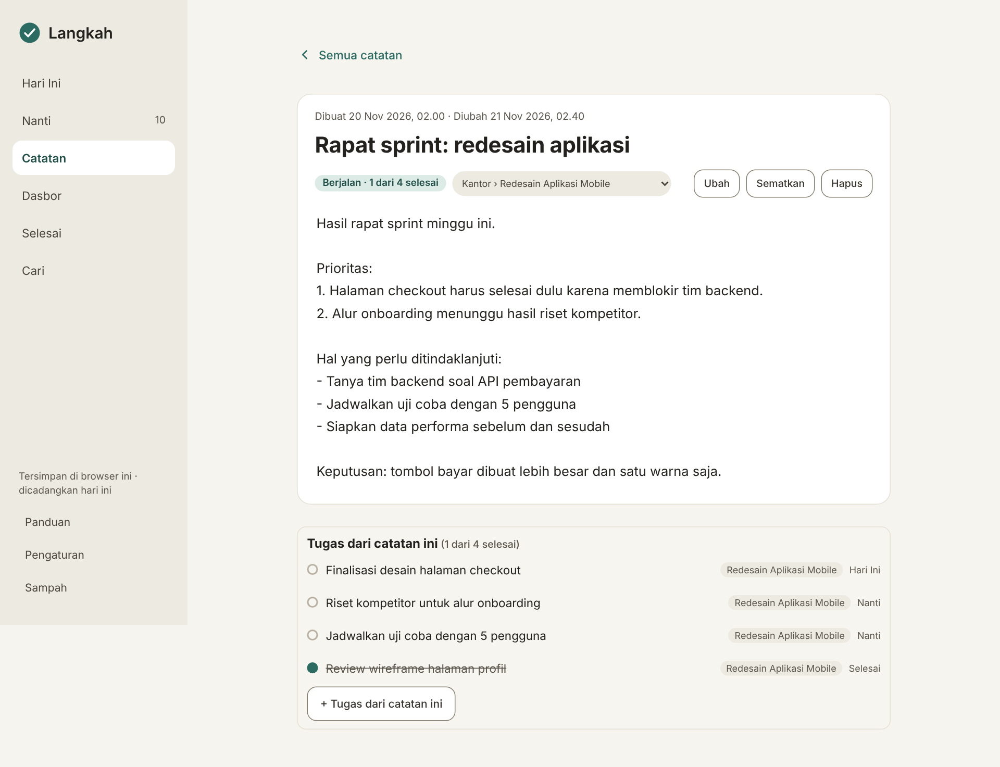</td>
    <td width="50%">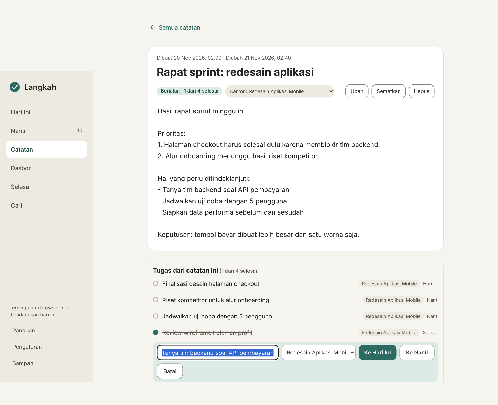</td>
  </tr>
  <tr>
    <td align="center"><sub>Detail catatan dan tugas-tugasnya</sub></td>
    <td align="center"><sub>Blok tulisan, jadikan tugas</sub></td>
  </tr>
</table>

### 8. Kerjaan, projek, dan Dasbor
Susunan dua tingkat: **Kerjaan** (misalnya Kantor, Konten, Pribadi) berisi **Projek**. Dasbor menampilkan progres setiap projek, dengan filter **Berjalan** (bawaan), **Selesai**, dan **Semua**. Kerjaan dan projek bisa diubah namanya atau dihapus, dan bisa dipulihkan dari Sampah.

<p align="center"></p>

### 9. Selesai
Riwayat yang sudah beres, dikelompokkan menjadi hari ini, kemarin, 7 hari terakhir, dan lebih lama, dengan filter yang sama. Tugas bisa dibuka lagi kalau ternyata belum beres.

<p align="center">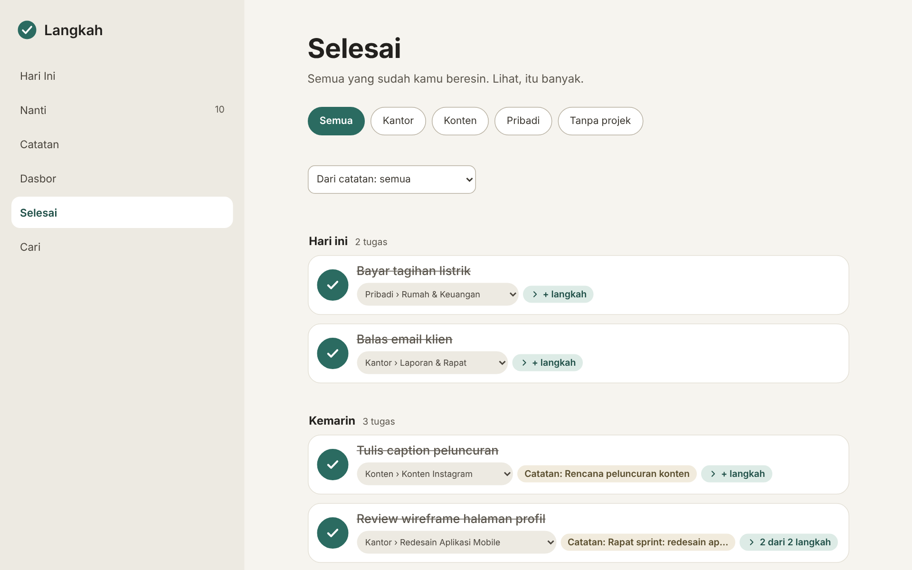</p>

### 10. Cari dan Sampah
**Cari** (`Ctrl+K`) menelusuri tugas, langkah, dan catatan sekaligus. **Sampah** menyimpan tugas, catatan, projek, dan kerjaan yang dihapus selama 30 hari, dan semuanya bisa dipulihkan.

<table>
  <tr>
    <td width="50%">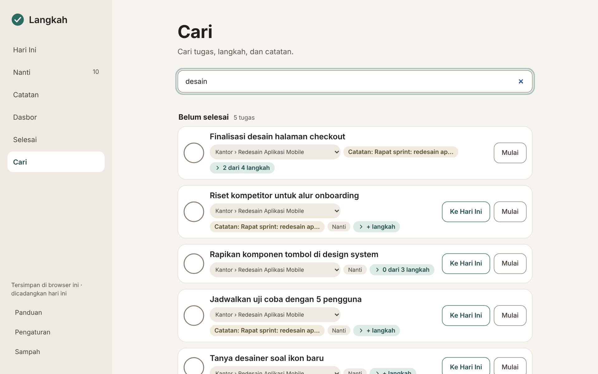</td>
    <td width="50%">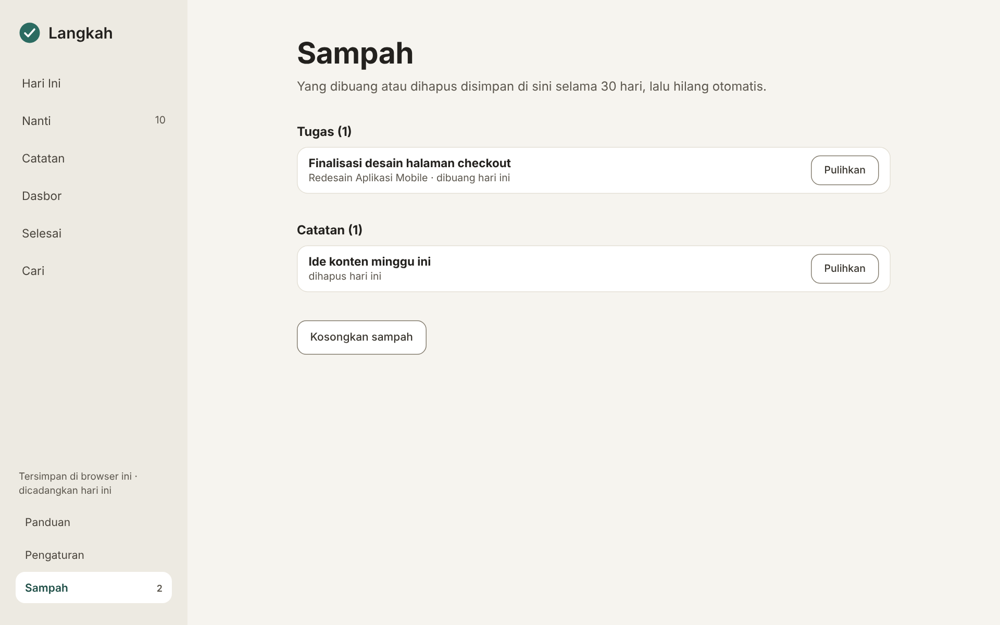</td>
  </tr>
</table>

### 11. Panduan di dalam aplikasi
Buka **Panduan** di bagian bawah menu samping (di HP: **Lainnya → Panduan**). Setiap fitur dijelaskan dengan bahasa sehari-hari **dan gambar contoh tampilannya**, dari "Mulai dalam satu menit" sampai cara memindahkan data ke HP baru. Pengguna baru disapa dengan tautan ke panduan ini. Gambar panduan ada di `docs/panduan/` dan baru dimuat saat bagiannya dibuka.

<p align="center">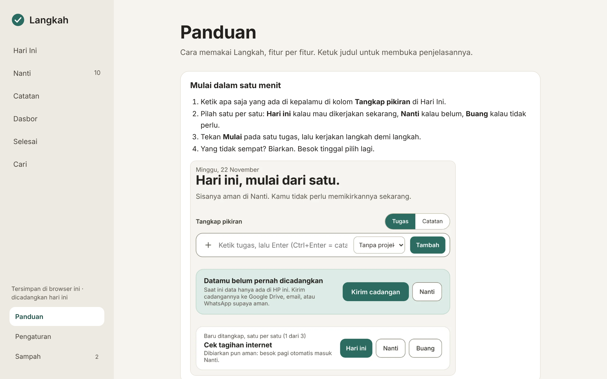</p>

### 12. Pengaturan, saran, dan nilai
Bagian bawah menu samping dibuat ringkas: satu baris status (misalnya "Tersinkron · 09.12") ditambah **Panduan**, **Pengaturan**, dan **Sampah**. Baris status berubah jadi peringatan hanya kalau ada yang perlu dilakukan, misalnya belum pernah dicadangkan atau file data perlu izin. **Pengaturan** (di HP: **Lainnya**) mengumpulkan tampilan, penyimpanan & cadangan, sinkron, notifikasi, dan masukan dalam satu halaman.

Pengguna bisa **mengirim saran, laporan masalah, atau nilai bintang** langsung dari aplikasi, tanpa akun apa pun. Kirimannya masuk ke Google Form milik pengelola. Yang terkirim hanya isian formulir, versi aplikasi, alamat situs Langkah yang dipakai (supaya terlihat apakah masukan datang dari versi asli atau dari fork), serta jenis perangkat dan browser, tanpa data tugas atau catatan. Kalau sedang offline atau jaringan memblokir Google, masukan disimpan dulu di perangkat dan dikirim otomatis saat tersambung lagi, ditandai "tertunda" beserta waktu menulisnya. Ajakan memberi nilai muncul paling banyak sekali, setelah dua minggu pemakaian.

<table>
  <tr>
    <td width="50%">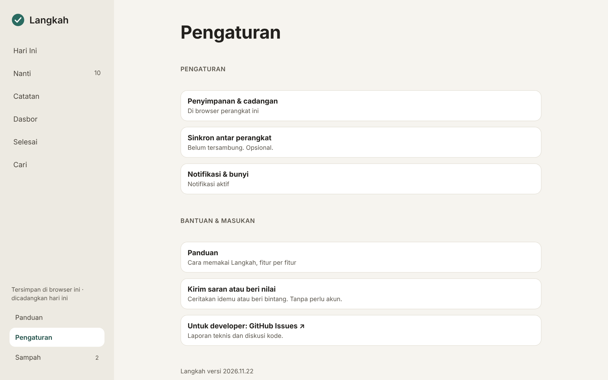</td>
    <td width="50%">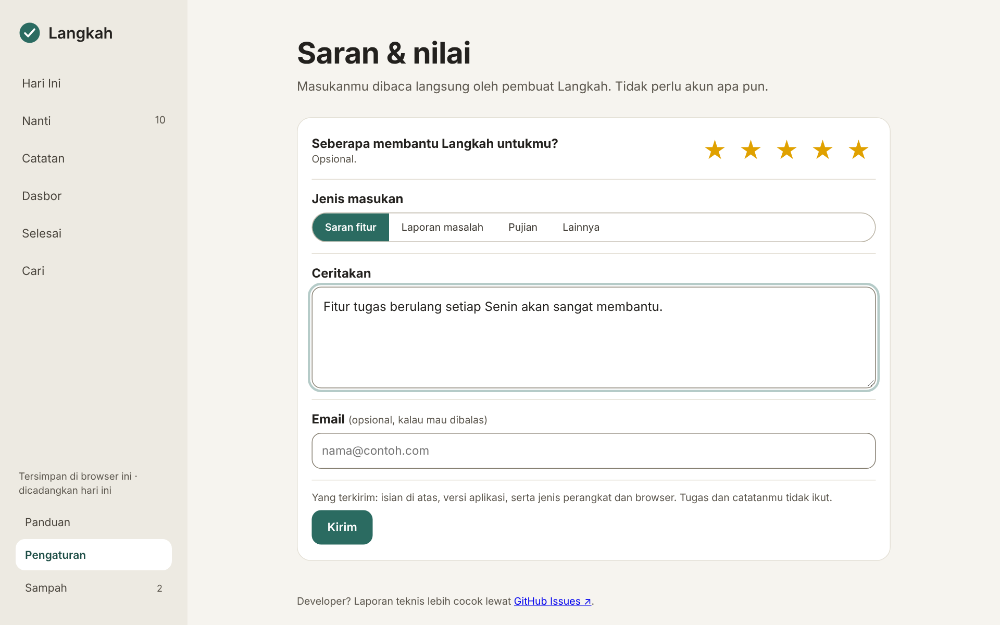</td>
  </tr>
  <tr>
    <td align="center"><sub>Pengaturan</sub></td>
    <td align="center"><sub>Saran & nilai</sub></td>
  </tr>
</table>

### 13. Di HP
Tata letaknya menyesuaikan layar kecil, dengan navigasi di bawah. Langkah bisa **dipasang sebagai aplikasi** (PWA) dengan ikon sendiri dan tetap terbuka tanpa internet.

<table>
  <tr>
    <td width="25%">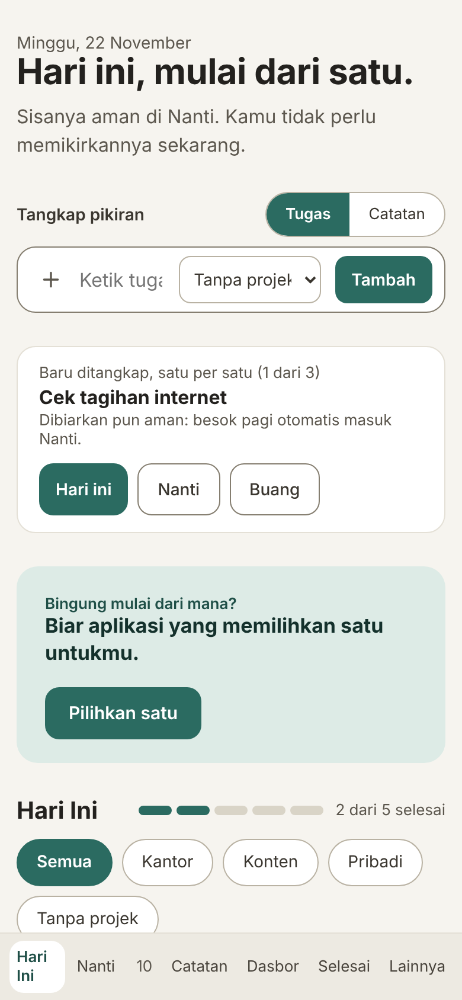</td>
    <td width="25%">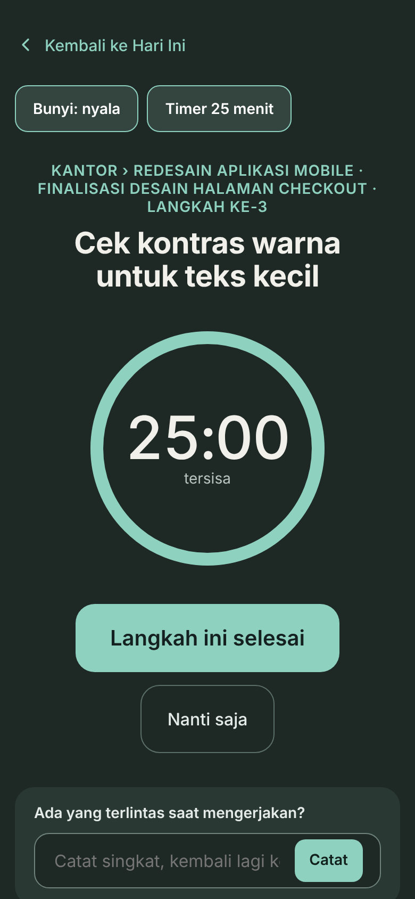</td>
    <td width="25%">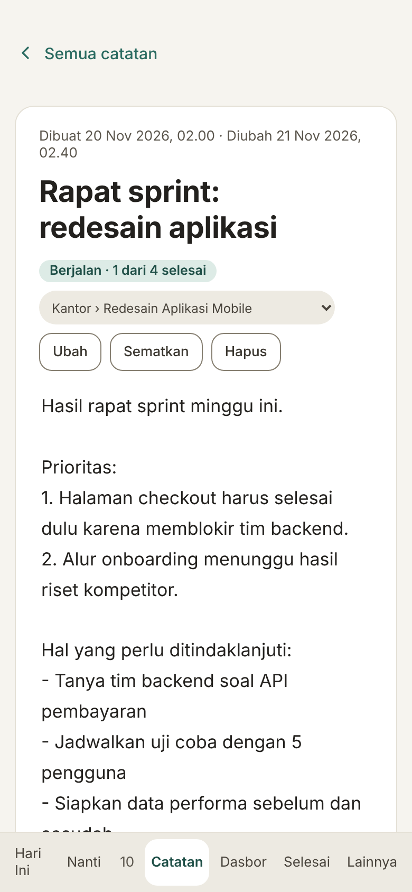</td>
    <td width="25%">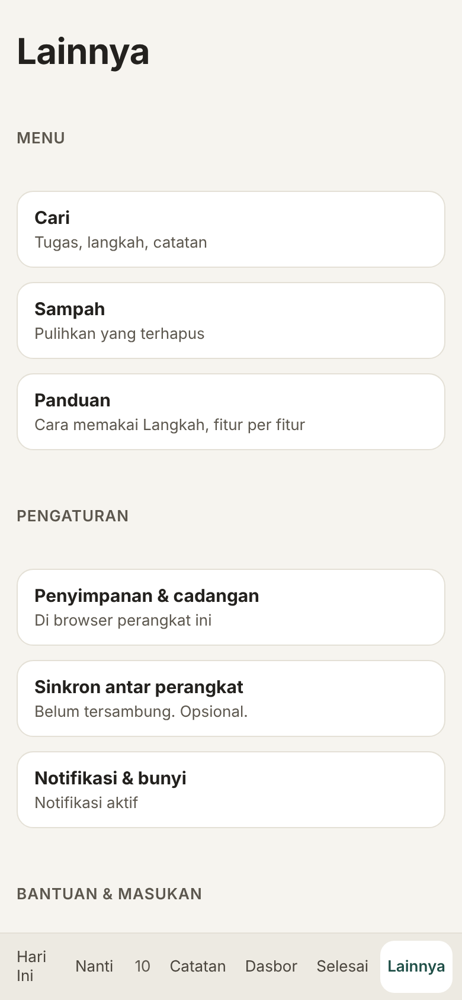</td>
  </tr>
  <tr>
    <td align="center"><sub>Hari Ini</sub></td>
    <td align="center"><sub>Fokus</sub></td>
    <td align="center"><sub>Detail catatan</sub></td>
    <td align="center"><sub>Lainnya</sub></td>
  </tr>
</table>

---

## Di mana data disimpan

Langkah tidak punya server dan tidak butuh akun. Pengaturannya ada di **Pengaturan → Penyimpanan & cadangan** (di HP: **Lainnya → Penyimpanan & cadangan**).

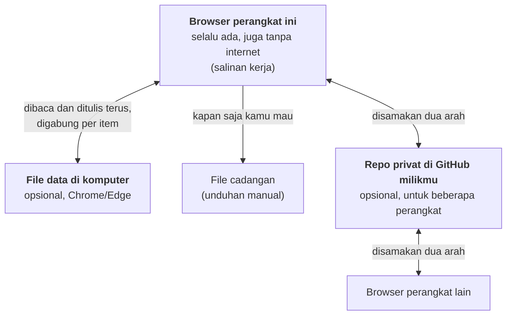

| Tempat | Kapan dipakai | Cara kerjanya |
|---|---|---|
| **Browser perangkat ini** | Selalu. | Setiap perubahan langsung tersimpan di `localStorage`. Ini salinan kerja yang membuat aplikasi cepat dan tetap jalan tanpa internet. Membersihkan data situs atau memakai mode penyamaran menghapusnya. |
| **Simpan data di file** | Opsional, Chrome atau Edge di komputer. | Kamu memilih satu file `.json` sebagai tempat data. Langkah **membaca** file itu saat dibuka, saat kamu kembali ke aplikasi, dan setiap 30 detik, lalu **menulis** ke sana setiap ada perubahan. Isi file dan browser digabung per item. Taruh filenya di folder OneDrive, Google Drive, atau Dropbox, dan komputer lain yang memakai folder itu ikut mendapat data yang sama. |
| **Cadangkan data** | Kapan saja. | Satu file cadangan berformat JSON. Di HP, **Kirim cadangan** membuka menu Bagikan, jadi file bisa langsung disimpan ke Google Drive, email, atau WhatsApp (sebagai `.txt`, karena menu Bagikan di Android tidak menerima `.json`). |
| **Sinkron antar perangkat** | Opsional, untuk laptop dan HP sekaligus. | Salinan di browser disamakan dua arah dengan satu file di repo GitHub privat milikmu. Lihat bagian berikut. |

Jadi:
- **Tanpa pengaturan apa pun**: data tersimpan di browser perangkat itu saja. Cadangkan sesekali supaya aman.
- **Dengan file data**: data tersimpan di file pilihanmu, dan browser memegang salinan kerjanya. Setelah browser dibuka ulang, Chrome biasanya meminta izin lagi untuk membuka file itu. Langkah menampilkan tombol **Buka file data** di atas halaman, dan perubahan yang dibuat sebelum izin diberikan tetap ditulis begitu file terbuka.
- **Dengan sinkron**: setiap perangkat menyimpan salinannya sendiri, dan semuanya disamakan lewat GitHub. Kalau satu perangkat hilang, datanya masih ada di perangkat lain dan di GitHub.

File data, sinkron, dan cadangan boleh dipakai bersamaan. Semuanya memakai cara penggabungan yang sama, jadi tidak saling menimpa.

Di browser yang mendukungnya, Langkah juga meminta **penyimpanan persisten** (`navigator.storage.persist()`) supaya browser tidak menghapus datanya sendiri saat memori hampir penuh. Chrome biasanya memberikannya setelah Langkah dipasang sebagai aplikasi atau notifikasi diizinkan. Statusnya terlihat di halaman Penyimpanan data.

### Memulihkan data dengan aman

Memulihkan bisa mengubah data di banyak tempat sekaligus, jadi alurnya dibuat supaya tidak ada yang berubah tanpa disadari:

1. **Pulihkan data**, lalu pilih file cadangan. Belum ada yang berubah.
2. Layar pemulihan menampilkan isi file dibanding data sekarang, lalu menawarkan dua cara:
   - **Gabungkan (disarankan)**: isi file ditambahkan, dan untuk item yang sama, versi yang terakhir diubah yang dipakai. Tidak ada yang dihapus.
   - **Ganti semuanya**: data dibuat persis seperti isi file. Layar ini menyebut apa saja yang ikut berubah, yaitu perangkat ini, file data, serta GitHub dan perangkat lain kalau sinkron aktif, lalu meminta konfirmasi kedua.
3. Sebelum mengganti, data yang sekarang disimpan dulu. Tombol **Urungkan** muncul setelahnya, dan **Batalkan pemulihan terakhir** tetap ada di halaman Penyimpanan data selama 7 hari.

Kalau sinkron aktif, **Riwayat versi** di halaman sinkron juga bisa mengembalikan data ke keadaan sebelumnya. Setiap sinkron tersimpan sebagai commit di repo datamu. Daftarnya menampilkan 5 versi terbaru lalu satu versi per hari, dan versi yang dipilih melewati layar pemulihan yang sama.

<table>
  <tr>
    <td width="50%">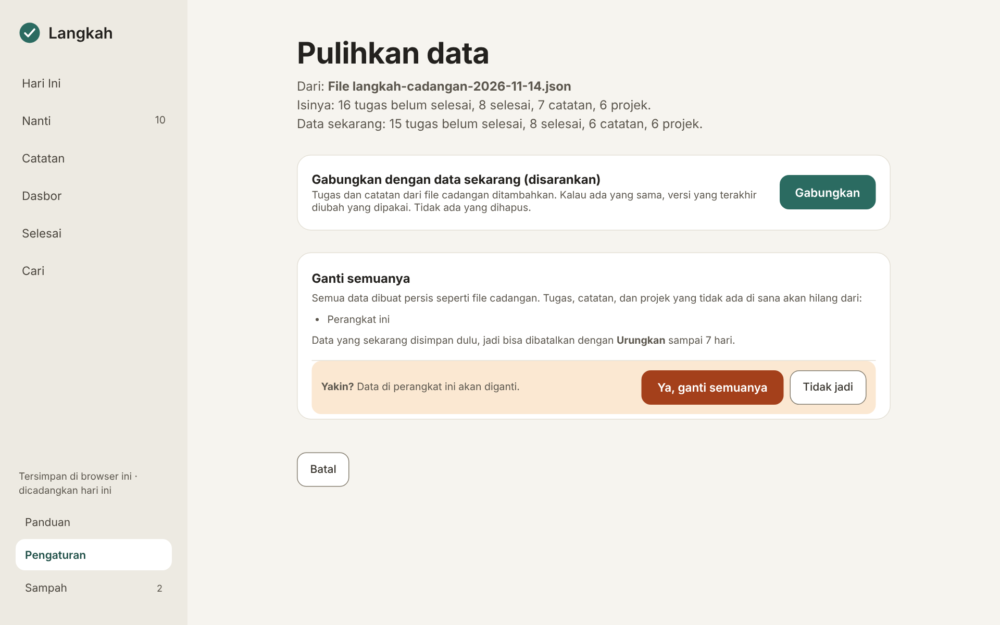</td>
    <td width="50%">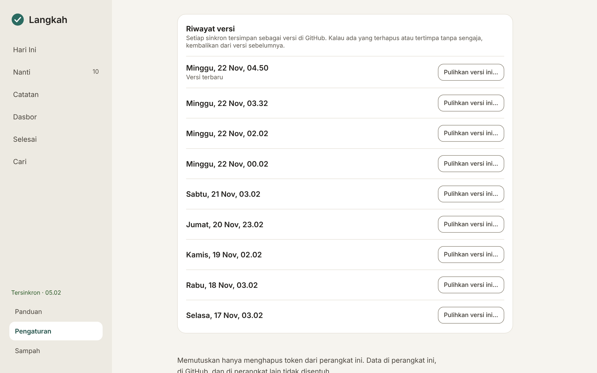</td>
  </tr>
  <tr>
    <td align="center"><sub>Gabungkan atau ganti semuanya</sub></td>
    <td align="center"><sub>Riwayat versi dari GitHub</sub></td>
  </tr>
</table>

<p align="center">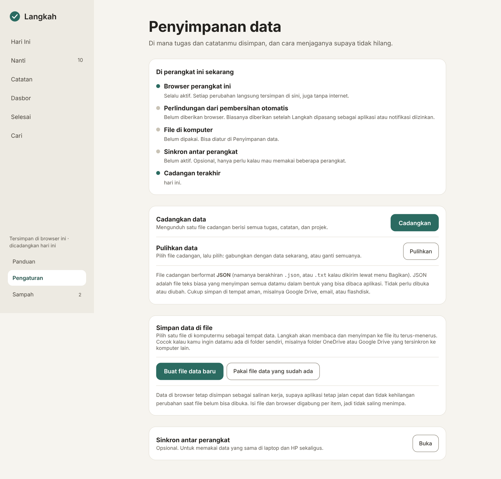</p>

---

## Pakai di beberapa perangkat (opsional)

Lewati bagian ini kalau kamu hanya memakai satu perangkat. Kalau semua perangkatmu komputer, cara yang lebih sederhana adalah **Simpan data di file** dengan file di folder OneDrive atau Google Drive.

Karena tidak ada server Langkah, data dari beberapa perangkat disamakan lewat **satu repositori privat di akun GitHub milikmu sendiri**. GitHub di sini hanya dipakai sebagai tempat penitipan file yang gratis dan privat. Kamu tidak perlu bisa coding. Cukup punya akun GitHub (gratis) dan melakukan persiapan sekali, sekitar 5 menit.

### Persiapan, sekali saja
1. Daftar di [github.com](https://github.com/signup) kalau belum punya akun.
2. Buat [repositori baru](https://github.com/new): beri nama `langkah-data`, pilih **Private**, centang **Add a README file**, lalu **Create repository**.
3. Buat [token akses](https://github.com/settings/personal-access-tokens/new), semacam kunci khusus untuk Langkah:
   - **Expiration**: pilih masa berlaku, misalnya 1 tahun.
   - **Repository access**: **Only select repositories**, lalu pilih `langkah-data`.
   - **Permissions**: tambahkan **Contents**, lalu pilih **Read and write**.
   - Tekan **Generate token**, lalu salin tokennya (diawali `github_pat_`). Token hanya ditampilkan sekali, jadi simpan di tempat aman.
4. Di Langkah buka **Sinkron antar perangkat**, isi `nama-akun/langkah-data` dan token tadi, lalu tekan **Hubungkan dan sinkron**.
5. Di perangkat lain, buka Langkah dan ulangi langkah 4 dengan nama repo dan token yang sama.

Data yang sudah ada di perangkat itu **digabung**, tidak ditimpa. Saat token kedaluwarsa, buat token baru dan hubungkan lagi.

Petunjuk yang sama, lengkap dengan tautan langsungnya, juga ada di halaman sinkron di dalam aplikasi.

<p align="center">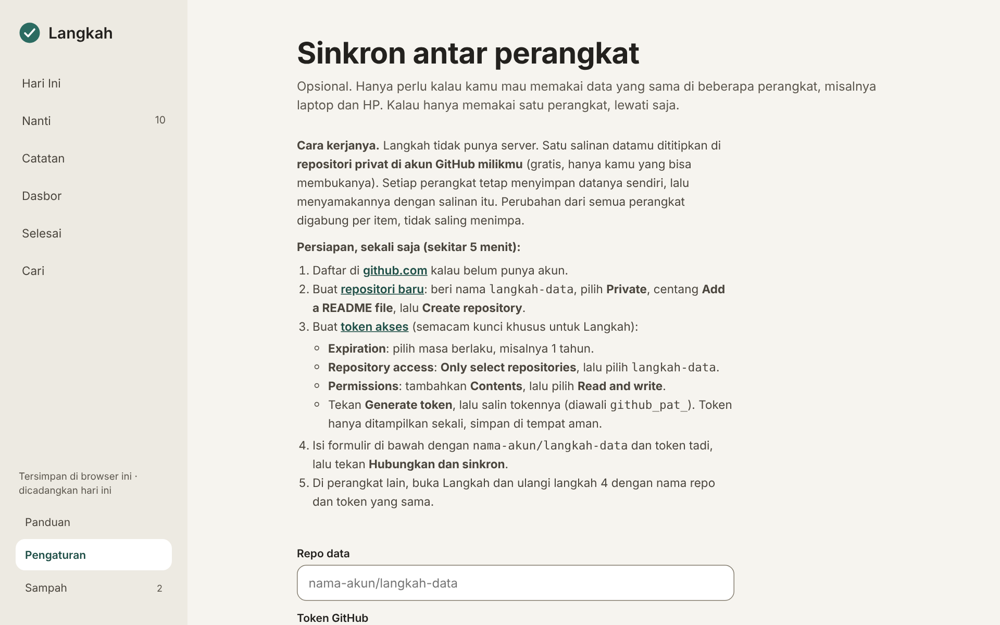</p>

### Cara kerjanya

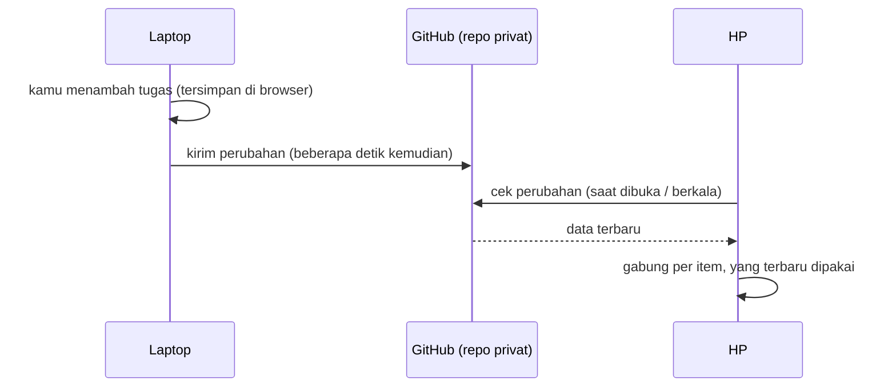

- **Kapan disamakan**: saat aplikasi dibuka, saat kamu kembali ke aplikasi, beberapa detik setelah ada perubahan, dan secara berkala selama aplikasi terbuka. Perubahan yang belum terkirim juga dikirim saat kamu pindah ke aplikasi lain.
- **Digabung per item**: setiap tugas, catatan, projek, dan kerjaan dibandingkan satu per satu. Yang terakhir diubah yang dipakai. Dua perangkat yang mengubah hal berbeda tidak saling menimpa.
- **Penghapusan ikut tersinkron**: item yang dihapus di satu perangkat tidak muncul lagi dari perangkat lain.
- **Sesi fokus ikut tersinkron**: tugas yang dimulai di laptop terlihat sedang berjalan di HP.
- **Offline tidak masalah**: perubahan tetap tersimpan di perangkat dan dikirim saat tersambung lagi.

### Pengaturan sinkron

Setelah tersambung, halaman sinkron punya dua pengaturan. Keduanya berlaku per perangkat, jadi HP bisa diatur lebih hemat daripada laptop.

| Pengaturan | Pilihan | Penjelasan |
|---|---|---|
| **Kirim otomatis setelah ada perubahan** | Nyala (bawaan) / Mati | Nyala: setiap perubahan, termasuk Mulai dan Akhiri sesi fokus, dikirim beberapa detik kemudian. Mati: perubahan dikumpulkan dan dikirim saat jadwal cek berikutnya atau saat kamu menekan **Sinkron sekarang**. Aplikasi menandai kalau ada perubahan yang belum terkirim. |
| **Cek perubahan dari perangkat lain** | Tiap 1, 2 (bawaan), 5, 15, atau 30 menit, atau Tidak berkala | Hanya berjalan saat aplikasi terbuka dan terlihat. Dengan **Tidak berkala**, data tetap disamakan saat aplikasi dibuka, saat kamu kembali ke aplikasi, dan saat menekan Sinkron sekarang. |

<p align="center">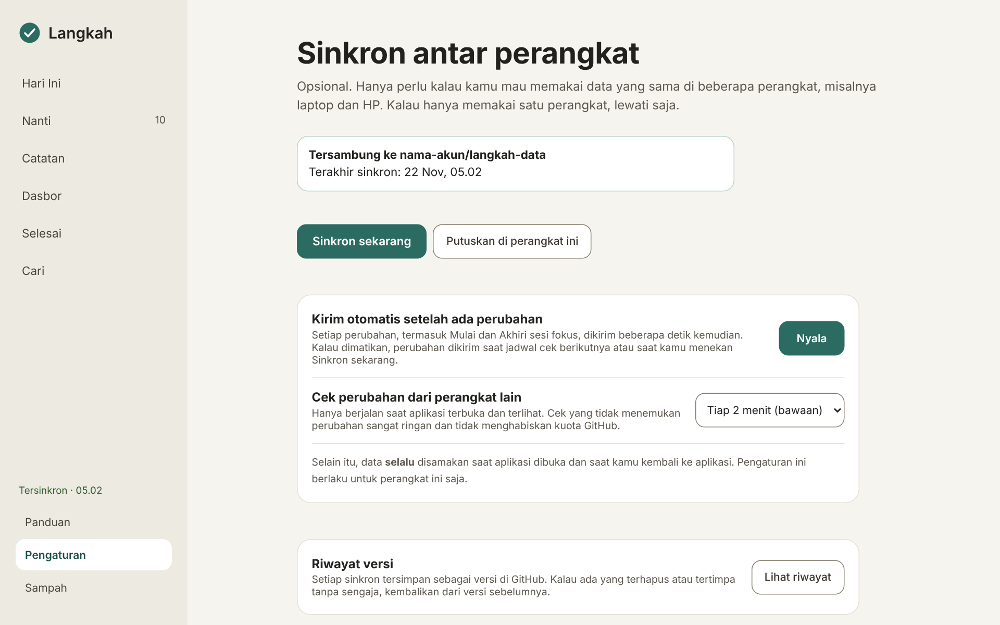</p>

<details>
<summary><b>Detail teknis sinkron</b></summary>

- Memakai GitHub Contents API (`GET` dan `PUT` satu file `data.json`) langsung dari browser.
- Penggabungan per item berdasarkan `updatedAt`. Penghapusan dicatat sebagai *tombstone* selama 60 hari.
- Konflik tulis (HTTP 409/422) dicoba ulang otomatis sampai 3 kali.
- Pengecekan memakai `ETag` dan permintaan bersyarat. Kalau tidak ada perubahan, GitHub membalas `304` tanpa isi, dan itu tidak menghabiskan batas API. Pengecekan beruntun dalam 20 detik diabaikan.
- Kalau token ditolak atau kedaluwarsa (HTTP 401/403), aplikasi berhenti mencoba sendiri sampai kamu menekan **Sinkron sekarang**.
- Token disimpan di `localStorage` perangkat itu saja dan hanya dikirim ke `api.github.com`. Token tidak ikut dalam file cadangan.

</details>

---

## Memakai Langkah

| Cara | Langkah |
|---|---|
| **Langsung di web** | Buka **https://farhanimaduddin.me/langkah/** |
| **Pasang di HP (Android)** | Buka alamat di atas di Chrome, pilih ⋮ lalu **Pasang aplikasi**. Saat pertama menekan **Mulai**, izinkan notifikasi. |
| **Pasang di laptop** | Di Chrome atau Edge, klik ikon pasang di kolom alamat. |
| **iPhone** | Safari → Bagikan → **Tambahkan ke Layar Utama**. Notifikasi butuh iOS 16.4 ke atas, dan tombol aksi notifikasi tidak tersedia. |
| **Coba data contoh** | **Pengaturan → Penyimpanan & cadangan → Pulihkan data**, lalu pilih `data-contoh.json` dari repo ini dan pilih **Gabungkan** atau **Ganti semuanya**. |
| **Membuka file `index.html` langsung** | Bisa, tapi browser membatasi beberapa fitur untuk file lokal: tombol di notifikasi, notifikasi yang muncul lagi, dan pemasangan aplikasi tidak tersedia, dan izin notifikasi bisa tidak terbaca dengan benar. Data di versi file juga terpisah dari versi web. Untuk pemakaian sehari-hari, pakai alamat web. |

### Pintasan keyboard
| Tombol | Fungsi |
|---|---|
| `/` | Tangkap cepat |
| `Ctrl+K` | Cari |
| `Enter` | Simpan sebagai tugas |
| `Ctrl+Enter` | Simpan sebagai catatan, atau simpan perubahan catatan |
| `Esc` | Batalkan pengeditan |

---

## Cara kerja

### Alur sebuah tugas

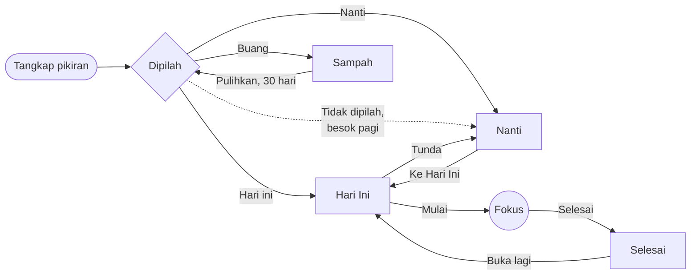

### Struktur data

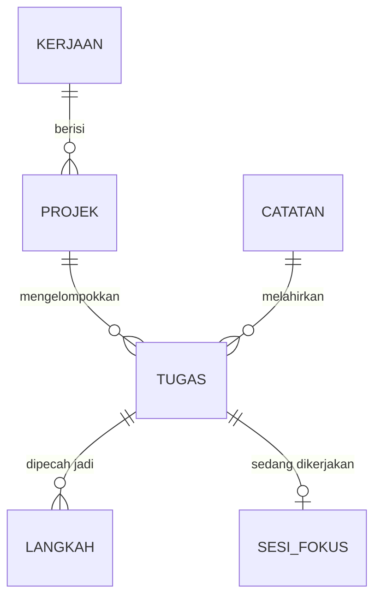

Semuanya disimpan sebagai satu objek JSON di `localStorage` browser (kunci `langkah.v1`). Setiap item punya `updatedAt` yang otomatis diperbarui saat isinya berubah, dan itu yang dipakai untuk menggabungkan data saat sinkron.

### Notifikasi di latar

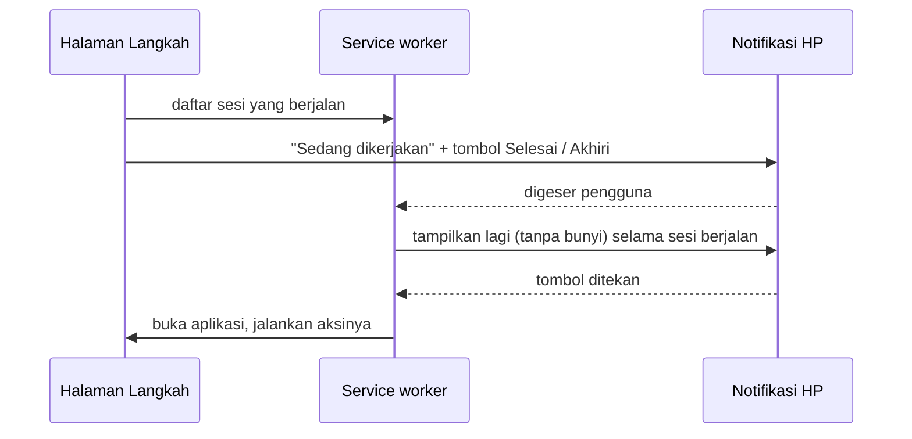

### Teknologi
- **Satu file `index.html`**: HTML, CSS, dan JavaScript murni. Tanpa framework, tanpa build, tanpa dependensi.
- Tampilan dibuat dari string HTML, dengan satu pendengar event untuk semua klik (event delegation).
- **Simpan data di file** memakai File System Access API. Izin file disimpan di IndexedDB, dan isi file digabung dengan fungsi yang sama dengan sinkron.
- `manifest.webmanifest` dan `sw.js` membuatnya bisa dipasang, terbuka tanpa internet, dan menangani tombol notifikasi. Service worker memakai strategi jaringan dulu, jadi versi baru langsung terambil.
- Bunyi dibuat langsung dengan Web Audio, tanpa berkas suara.

---

## Privasi dan keamanan

- **Tanpa server, tanpa akun, tanpa analitik.** Tidak ada data yang dikirim ke pihak lain, kecuali ke GitHub dan hanya bila kamu mengaktifkan sinkron.
- **Repositori ini tidak berisi data pribadi siapa pun.** Isinya hanya kode dan data contoh.
- **Token GitHub** disimpan di browser perangkat itu saja. Pakai token **fine-grained** yang dibatasi ke satu repo data, hanya izin Contents, dan beri masa berlaku. Jangan memakai token berizin luas.
- Untuk memutus akses di sebuah perangkat, pakai **Putuskan di perangkat ini**, lalu cabut tokennya di GitHub bila perlu.
- Di komputer bersama, sebaiknya jangan menghubungkan sinkron atau menyimpan data di browser itu.

## Batasan yang perlu diketahui

- **Notifikasi di latar.** Bunyi di aplikasi hanya terdengar selama aplikasinya terbuka. Kalau Android membekukan aplikasi, notifikasi "Waktu habis" bisa terlambat sampai aplikasi dibuka lagi, tapi jamnya tetap benar. Atur baterai ke **Tidak dibatasi** untuk mengurangi hal ini.
- **Hitung mundur di notifikasi** tidak tersedia untuk aplikasi web, jadi notifikasi menampilkan jam selesainya.
- **Notifikasi yang benar-benar tidak bisa digeser** tidak tersedia untuk web. Sebagai gantinya, notifikasi muncul lagi setelah digeser.
- **Tombol aksi di notifikasi** didukung Chrome di Android serta Chrome dan Edge di komputer, tidak di iOS.
- **Simpan data di file** hanya ada di Chrome dan Edge di komputer, dan browser biasanya meminta izin lagi setiap kali dibuka ulang.
- **Formulir masukan** tidak punya perlindungan spam selain batas satu kiriman per 30 detik di aplikasi, dan rata-rata nilai belum ditampilkan di aplikasi.
- **Sinkron tidak real-time**: perangkat lain menerima perubahan sesuai jadwal cek, atau saat aplikasinya dibuka.

---

## Kontribusi dan saran

Langkah terbuka untuk siapa saja.

### Fork dan pakai sendiri
Silakan **fork** repo ini dan ubah sesukamu, misalnya mengganti bahasa, warna, atau menambah fitur untuk kebutuhanmu sendiri. Untuk meng-hosting versimu:
1. Tekan **Fork** di kanan atas halaman repo ini.
2. Di repo hasil fork, buka **Settings → Pages**, pilih cabang `main` dan folder `/ (root)`, lalu **Save**.
3. Beberapa menit kemudian aplikasimu bisa dibuka di `https://nama-akun.github.io/langkah/`.

### Saran fitur, laporan masalah, dan nilai
- **Pengguna biasa**: di aplikasi buka **Pengaturan → Kirim saran atau beri nilai**. Tidak perlu akun apa pun.
- **Developer**: buka tab **[Issues](https://github.com/dudin12/langkah/issues/new/choose)** dan pilih **Saran fitur** atau **Laporan masalah**. Ini cocok untuk laporan teknis dan diskusi kode.

### Formulir masukan di fork-mu
Formulir masukan mengirim ke Google Form milik pengelola repo ini. Kalau kamu meng-hosting fork sendiri, ganti tujuannya supaya masukan pengguna versimu masuk ke formulirmu:
1. Buat Google Form dengan 5 pertanyaan **Jawaban singkat**, semuanya tidak wajib: Jenis masukan, Nilai (1-5), Pesan, Email (opsional), dan Info perangkat. Biarkan "Kumpulkan alamat email" pada **Jangan kumpulkan**, lalu **Publikasikan** untuk siapa saja yang memiliki link.
2. Ambil ID setiap pertanyaan lewat **⋮ → Dapatkan link yang sudah diisi otomatis**. Isi setiap kolom, ambil linknya, dan ID-nya berbentuk `entry.123456789`.
3. Di `index.html`, cari `var FB=` lalu ganti `action` dengan `https://docs.google.com/forms/d/e/<ID-formulir>/formResponse` dan isi kelima `entry`-nya. Kosongkan `action` untuk menyembunyikan formulir dan hanya menampilkan tautan GitHub.

### Mengirim perubahan kode
1. Fork repo ini dan buat cabang baru untuk perubahanmu.
2. Ubah `index.html`, lalu buka langsung di browser untuk mencoba. Tidak ada build atau dependensi.
3. Coba di layar lebar dan layar HP (DevTools → mode perangkat), dan pastikan data lama tetap terbaca.
4. Kirim **Pull Request** dengan penjelasan singkat: apa yang berubah, kenapa, dan tangkapan layar bila tampilannya berubah.

Beberapa pegangan supaya Langkah tetap konsisten:
- **Tetap satu file dan JavaScript murni**, tanpa framework, build, atau layanan pihak ketiga.
- **Tetap tenang**: tidak ada warna merah untuk "terlambat", tidak ada angka yang menghakimi, dan setiap aksi bisa dibatalkan.
- **Teks antarmuka berbahasa Indonesia** yang ramah dan sederhana.
- **Data pengguna adalah prioritas**: perubahan struktur data harus tetap bisa membaca data versi lama.
- Kalau mengubah `sw.js`, naikkan versi cache di dalamnya supaya pengguna mendapat versi baru.

## Lisensi

[MIT](LICENSE). Bebas dipakai, diubah, dan dibagikan, termasuk untuk keperluan komersial, selama pemberitahuan lisensinya tetap disertakan.

## Isi repositori

```
index.html              seluruh aplikasi (HTML + CSS + JS)
manifest.webmanifest    metadata pemasangan sebagai aplikasi
sw.js                   service worker: cache offline, tombol notifikasi, notifikasi yang muncul lagi
icon-192.png, icon-512.png
data-contoh.json        data contoh untuk mencoba
docs/screenshots/       tangkapan layar di README ini
docs/panduan/           gambar untuk halaman Panduan di dalam aplikasi
.github/ISSUE_TEMPLATE/ formulir saran fitur dan laporan masalah
LICENSE                 lisensi MIT
```

---

<div align="center">
<sub>Satu langkah kecil sudah cukup untuk mulai.</sub>
</div>
