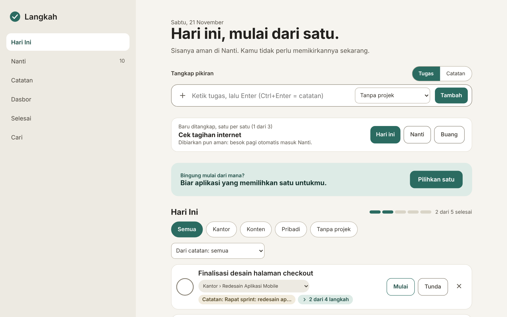
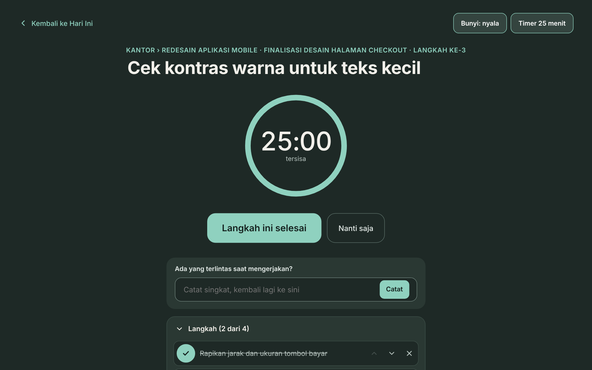
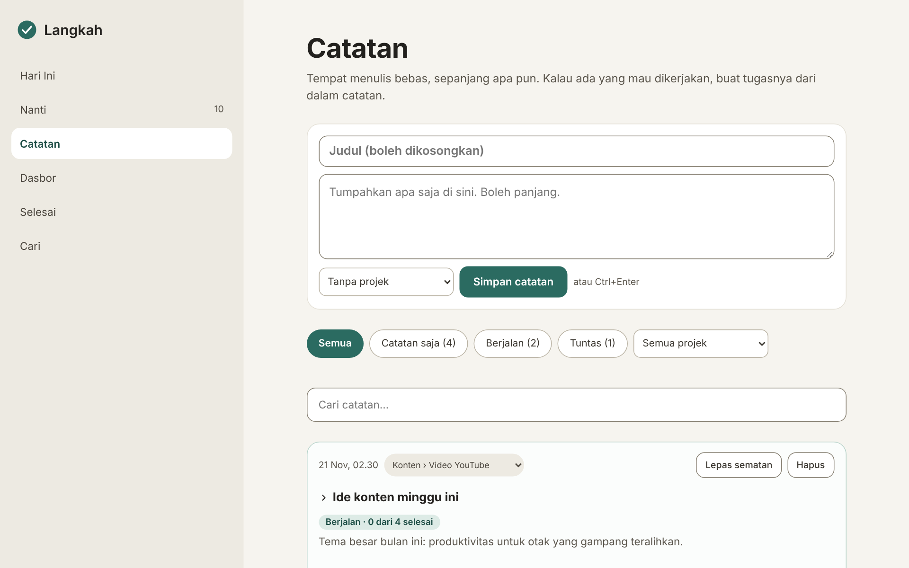
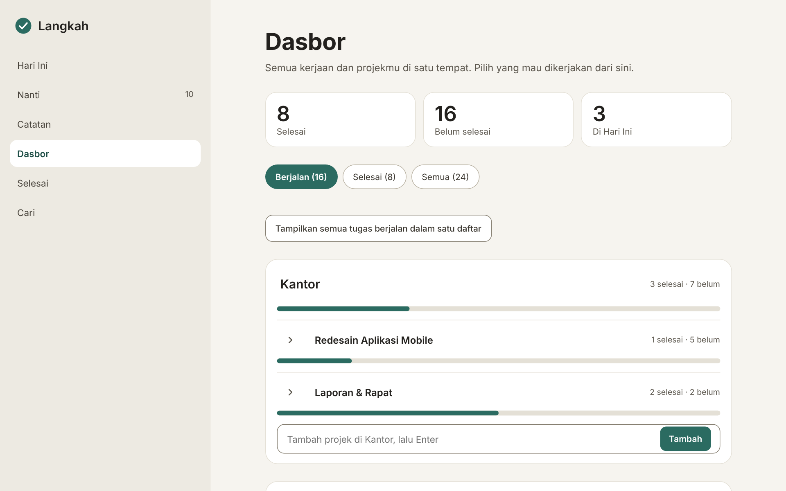
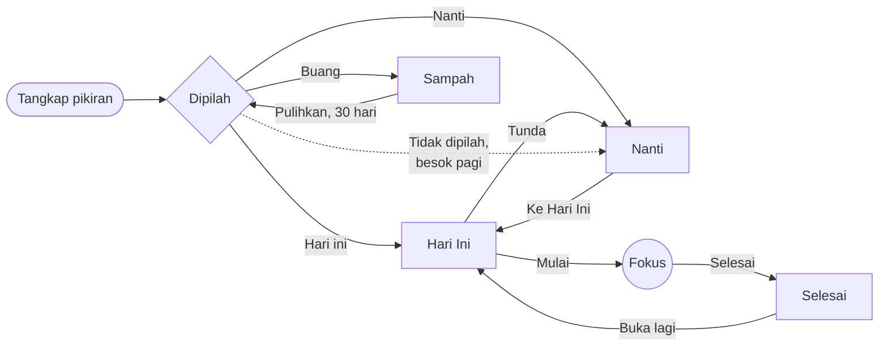
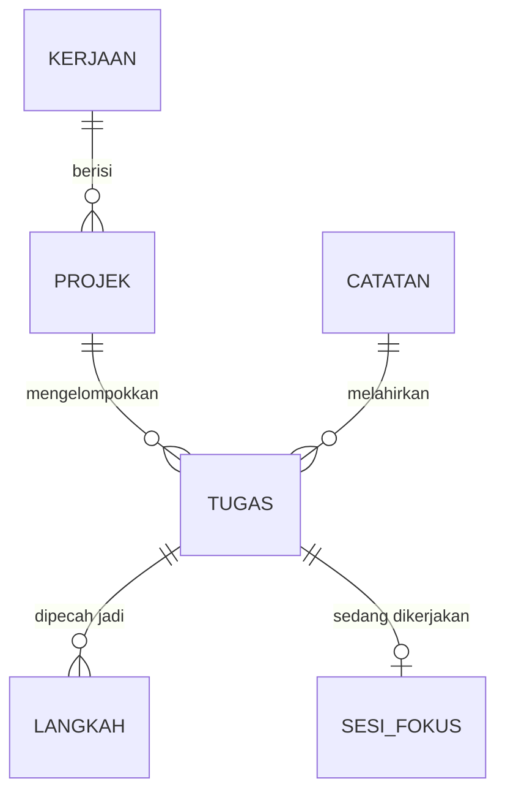
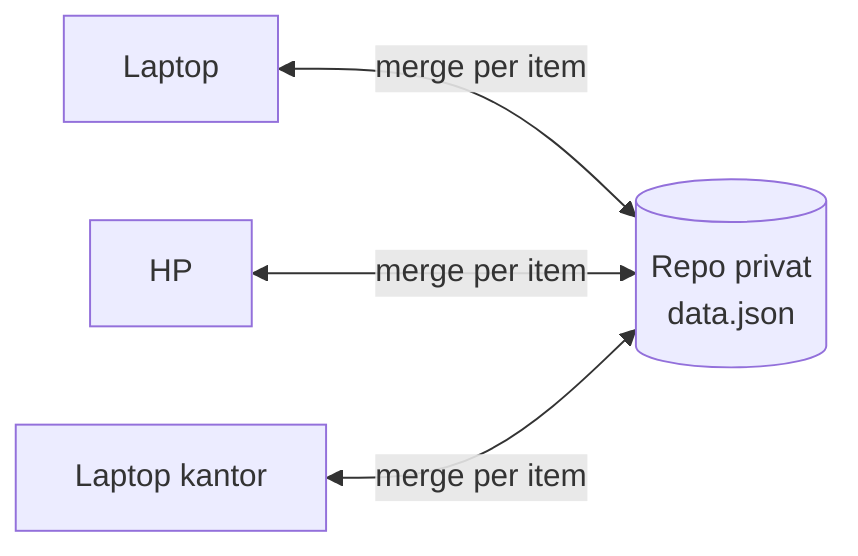

<div align="center">


# Langkah

**Pelacak tugas yang ramah ADHD. Satu langkah kecil dalam satu waktu.**

Satu file HTML, tanpa server, tanpa akun, tanpa pelacak. Data tetap milikmu.

[**Buka aplikasi**](https://farhanimaduddin.me/langkah/) · [Fitur](#fitur) · [Cara kerja](#cara-kerja) · [Sinkron antar perangkat](#sinkron-antar-perangkat) · [Privasi](#privasi-dan-keamanan)

</div>

<p align="center">
  
</p>

> Semua tangkapan layar di sini memakai **data contoh** (`data-contoh.json`), bukan data pribadi.

---

## Kenapa Langkah

Kebanyakan aplikasi tugas menampilkan semuanya sekaligus. Daftar yang panjang itu sendiri yang membuat sulit memulai. Langkah dibuat dengan arah sebaliknya:

| Prinsip | Wujudnya di aplikasi |
|---|---|
| **Tampilkan sedikit** | Halaman Hari Ini hanya berisi yang kamu pilih untuk hari ini. Sisanya aman di Nanti. |
| **Tangkap dulu, putuskan nanti** | Pikiran yang lewat ditulis dalam satu kolom, lalu dipilah satu per satu: Hari ini, Nanti, atau Buang. |
| **Tugas besar dipecah** | Setiap tugas bisa punya langkah kecil. Mode Fokus hanya menampilkan satu langkah di depan mata. |
| **Tidak menghukum** | Tangkapan yang belum dipilah otomatis pindah ke Nanti keesokan harinya, dan tidak ada daftar "terlambat" berwarna merah. |
| **Selalu bisa dibatalkan** | Menghapus, memindahkan, atau menyelesaikan bisa di-undo, dan yang dibuang masuk Sampah selama 30 hari. |

## Tangkapan layar

<table>
  <tr>
    <td width="50%"><b>Mode Fokus</b><br>Satu langkah, timer, dan bunyi saat waktu habis.<br></td>
    <td width="50%"><b>Nanti</b><br>Tempat aman untuk semua yang belum perlu dipikirkan.<br></td>
  </tr>
  <tr>
    <td width="50%"><b>Catatan</b><br>Catatan panjang bisa melahirkan beberapa tugas.<br></td>
    <td width="50%"><b>Dasbor</b><br>Kerjaan dan projek beserta progresnya.<br></td>
  </tr>
  <tr>
    <td width="50%"><b>Selesai</b><br>Riwayat yang sudah beres, dikelompokkan per waktu.<br></td>
    <td width="50%" align="center"><b>Di HP</b><br>Tata letaknya menyesuaikan layar kecil.<br> </td>
  </tr>
</table>

---

## Fitur

### Menangkap dan memilah
- **Tangkap pikiran** dari satu kolom. `Enter` menyimpan sebagai tugas, `Ctrl+Enter` sebagai catatan. Tombol **Tambah** juga ada untuk keyboard HP.
- **Pemilahan satu per satu.** Tugas baru muncul satu per satu dengan tiga pilihan: **Hari ini**, **Nanti**, **Buang**.
- **Pilihkan satu.** Bingung mulai dari mana? Aplikasi memilihkan satu tugas dari Hari Ini.
- **Penyapuan otomatis.** Tangkapan yang belum dipilah sampai besok pagi pindah ke Nanti. Tugas Hari Ini yang belum selesai tetap di Hari Ini dan diberi penanda dari hari sebelumnya, tanpa label terlambat.

### Hari Ini, Nanti, dan Selesai
- **Hari Ini** dengan penanda progres dan filter menurut projek atau catatan asal.
- **Nanti** dengan filter menurut kerjaan.
- **Selesai** dikelompokkan menurut waktu, dengan filter yang sama.

### Kerjaan, projek, dan Dasbor
- Susunan dua tingkat: **Kerjaan** (misalnya Kantor, Pribadi) berisi **Projek**.
- Dasbor menampilkan progres tiap projek, dengan filter **Berjalan** (bawaan), **Selesai**, dan **Semua**.
- Kerjaan dan projek bisa diarsipkan tanpa kehilangan isinya.

### Catatan
- Catatan punya **judul dan isi** yang bisa panjang.
- Blok sebagian tulisan, lalu ubah jadi **tugas**. Judul tugas terisi otomatis dan tugas tetap tertaut ke catatannya.
- Satu catatan bisa melahirkan banyak tugas, bahkan ke projek yang berbeda.
- Status catatan dihitung otomatis: **Catatan** (belum ada tugas), **Berjalan** (ada tugas terbuka), **Tuntas** (semua tugasnya selesai).
- Catatan bisa disematkan, difilter menurut status dan projek.

### Mode Fokus
- Menampilkan **satu langkah** saja dengan jam yang besar.
- **Timer** dengan tombol cepat 10/15/25 menit, atau isi **menit sendiri** (1 sampai 720).
- Kolom **"Ada yang terlintas?"** untuk mencatat pikiran yang mengganggu tanpa keluar dari fokus.
- **Beberapa tugas bisa berjalan bersamaan**, masing-masing dengan timernya sendiri.
- Keluar dari Fokus tidak mengakhiri sesi. Bar di atas halaman menampilkan jam yang terus berjalan dengan tombol Lanjutkan dan Akhiri.
- Saat waktu habis: nada berbunyi (berulang tiap 10 detik sampai 1 menit), perangkat bergetar, judul tab berubah, dan notifikasi muncul dengan tombol **+5 menit** dan **Akhiri**.
- Sesi **ikut tersinkron** antar perangkat bila sinkron GitHub aktif.

### Lainnya
- **Cari** di seluruh tugas dan catatan (`Ctrl+K`, atau `/` untuk tangkap cepat).
- **Sampah** dengan pemulihan 30 hari untuk tugas, catatan, projek, dan kerjaan.
- **Cadangan**: ekspor dan impor JSON, simpan otomatis ke satu file di komputermu, dan pengingat bila lama tidak dicadangkan.
- **Pasang sebagai aplikasi** (PWA) di HP dan laptop, dengan ikon sendiri dan bisa dibuka tanpa internet.
- **Dua tab terbuka** tetap konsisten, tidak saling menimpa.

---

## Cara kerja

### Alur sebuah tugas



### Struktur data



Semuanya disimpan sebagai satu objek JSON di `localStorage` browser (kunci `langkah.v1`). Setiap item punya `updatedAt` yang otomatis diperbarui saat isinya berubah. Itu dasar sinkron.

### Teknologi
- **Satu file `index.html`**: HTML, CSS, dan JavaScript murni. Tanpa framework, tanpa build, tanpa dependensi.
- Tampilan dibuat dari string HTML dengan penanganan klik lewat satu pendengar event (event delegation).
- `manifest.webmanifest` dan `sw.js` membuatnya bisa dipasang dan terbuka tanpa internet. Service worker memakai strategi jaringan dulu, sehingga versi baru langsung terambil.

---

## Sinkron antar perangkat

Langkah tidak punya server. Untuk memakainya di beberapa perangkat, data disimpan di **repositori GitHub privat milikmu sendiri** lewat GitHub Contents API.



**Cara memasang**
1. Buat repositori **privat** kosong, misalnya `langkah-data`.
2. Di GitHub: *Settings → Developer settings → Personal access tokens → Fine-grained tokens*. Pilih **hanya repo itu**, izin **Contents: Read and write**, dan beri masa berlaku.
3. Di Langkah buka **Lainnya → Sinkron**, isi nama repo (`pemilik/langkah-data`) dan tempel token, lalu **Hubungkan**.
4. Ulangi langkah 3 di tiap perangkat. Data di semua perangkat akan digabung.

**Bagaimana penggabungan bekerja**
- Tiap tugas, catatan, projek, dan kerjaan digabung **per item**. Versi dengan `updatedAt` paling baru yang menang. Dua perangkat yang mengubah hal berbeda tidak saling menimpa.
- Penghapusan dicatat sebagai **tombstone** (60 hari) supaya item yang dihapus di satu perangkat tidak hidup lagi dari perangkat lain.
- Konflik tulis (HTTP 409/422) dicoba ulang otomatis sampai 3 kali.
- **Hemat lalu lintas**: cek berkala memakai `ETag` dan permintaan bersyarat. Jika tidak ada perubahan, GitHub membalas `304` tanpa isi, dan itu tidak menghabiskan batas API. Cek berkala hanya jalan **tiap 2 menit saat tab terlihat**, dan permintaan beruntun dalam 20 detik diabaikan.
- Bila token ditolak atau kedaluwarsa, aplikasi berhenti mencoba sendiri sampai kamu menekan **Sinkron sekarang**.
- **Sesi fokus** juga ikut tersinkron, dikirim langsung saat Mulai, memasang timer, atau Akhiri.

---

## Memakai Langkah

**Langsung di web**: buka **https://farhanimaduddin.me/langkah/**.

**Pasang di HP (Android/Chrome)**: buka alamat di atas, pilih menu ⋮ lalu **Pasang aplikasi**.

**Jalankan sendiri**: unduh `index.html` lalu buka di browser. Tidak perlu server. Untuk fitur pasang aplikasi dan notifikasi, simpan semua berkas di hosting HTTPS (misalnya GitHub Pages).

**Coba dengan data contoh**: *Lainnya → Cadangan → Pulihkan dari JSON*, lalu pilih `data-contoh.json`.

**Bila dipasang lewat GitHub Pages**: unggah `index.html`, `manifest.webmanifest`, `sw.js`, `icon-192.png`, dan `icon-512.png` ke akar repositori, lalu aktifkan *Settings → Pages* dari cabang `main`.

### Pintasan keyboard
| Tombol | Fungsi |
|---|---|
| `/` | Tangkap cepat |
| `Ctrl+K` | Cari |
| `Enter` | Simpan sebagai tugas |
| `Ctrl+Enter` | Simpan sebagai catatan |
| `Esc` | Batalkan pengeditan |

---

## Privasi dan keamanan

- **Tanpa server, tanpa akun, tanpa analitik.** Tidak ada yang dikirim ke pihak lain selain ke GitHub, dan itu pun hanya jika kamu mengaktifkan sinkron.
- **Data pribadimu tidak ada di repositori ini.** Repositori ini publik dan hanya berisi kode serta data contoh. Datamu ada di `localStorage` browser dan, bila sinkron aktif, di repositori privat milikmu.
- **Token GitHub disimpan di browser perangkat itu saja** (`localStorage`), tidak pernah dikirim ke tempat lain selain `api.github.com`. Karena itu, buatlah token **fine-grained** yang terbatas pada satu repo data, hanya izin Contents, dan beri masa berlaku. Jangan memakai token berizin luas.
- Untuk memutus akses di sebuah perangkat, pakai **Putuskan di perangkat ini**, lalu cabut token di GitHub bila perlu.
- Di komputer bersama, jangan hubungkan sinkron dan jangan simpan datamu di browser itu.

## Batasan yang perlu diketahui

- **Notifikasi dan bunyi** berjalan selama aplikasi terbuka atau masih hidup di latar. Bila Android membekukan atau menutup browser, notifikasi "Waktu habis" bisa terlambat sampai aplikasi dibuka lagi. Jam di aplikasi tetap benar karena dihitung dari waktu mulai.
- **Tombol aksi di notifikasi** (Selesai, Akhiri, +5 menit) didukung Chrome Android dan Chrome/Edge di komputer, bukan di iOS.
- Sinkron bukan real-time: perangkat lain menerima perubahan paling lama sekitar 2 menit kemudian, atau saat aplikasi dibuka.
- Data hanya ada di browser sampai kamu mencadangkan atau mengaktifkan sinkron. Membersihkan data situs menghapusnya.

## Isi repositori

```
index.html              seluruh aplikasi (HTML + CSS + JS)
manifest.webmanifest    metadata pemasangan sebagai aplikasi
sw.js                   service worker: cache offline + aksi notifikasi
icon-192.png, icon-512.png
data-contoh.json        data contoh untuk mencoba
docs/screenshots/       tangkapan layar di README ini
```

---

<div align="center">
<sub>Dibuat dengan pelan-pelan. Satu langkah kecil sudah cukup.</sub>
</div>
